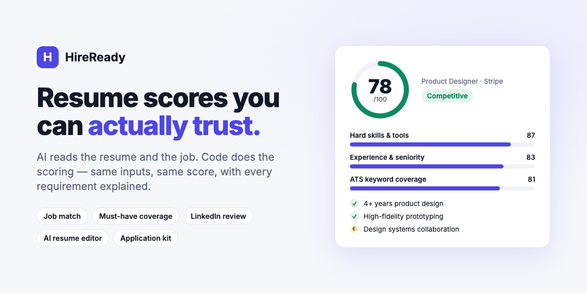
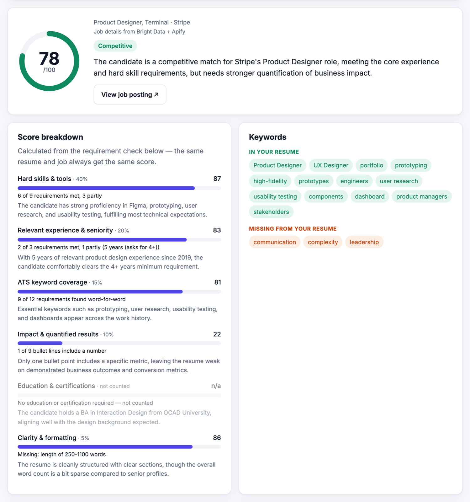
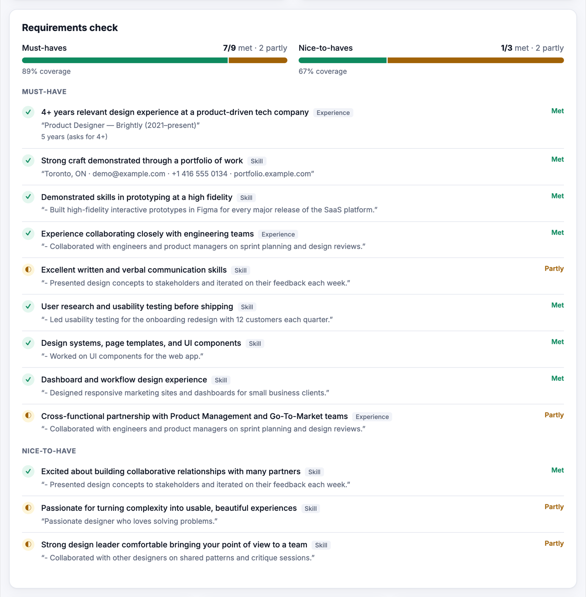
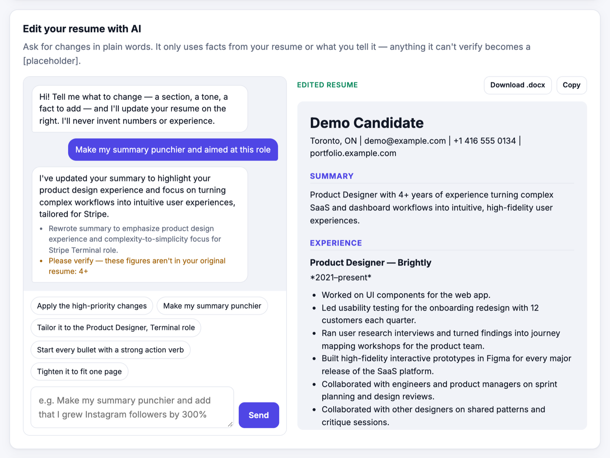
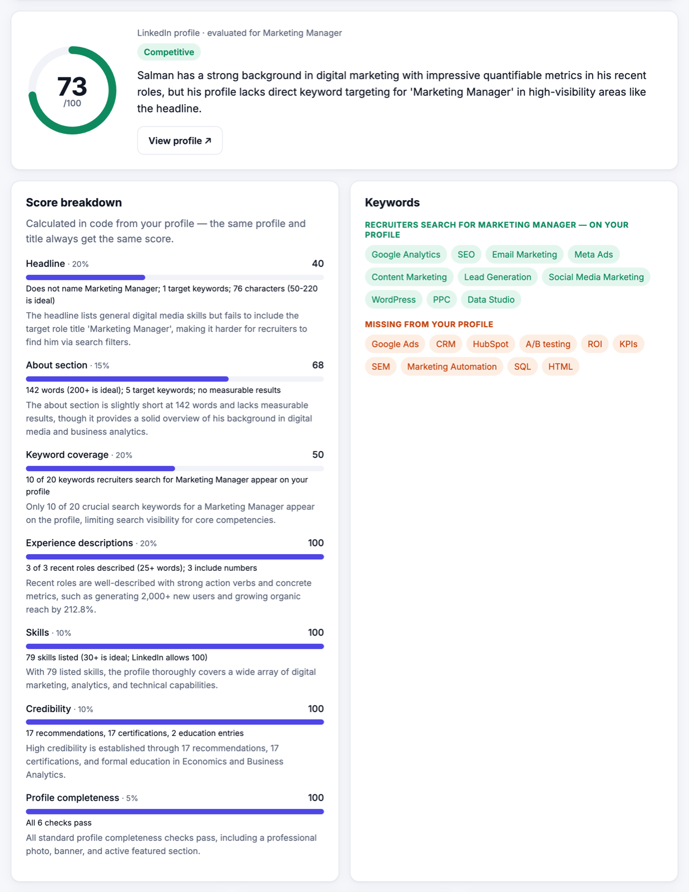
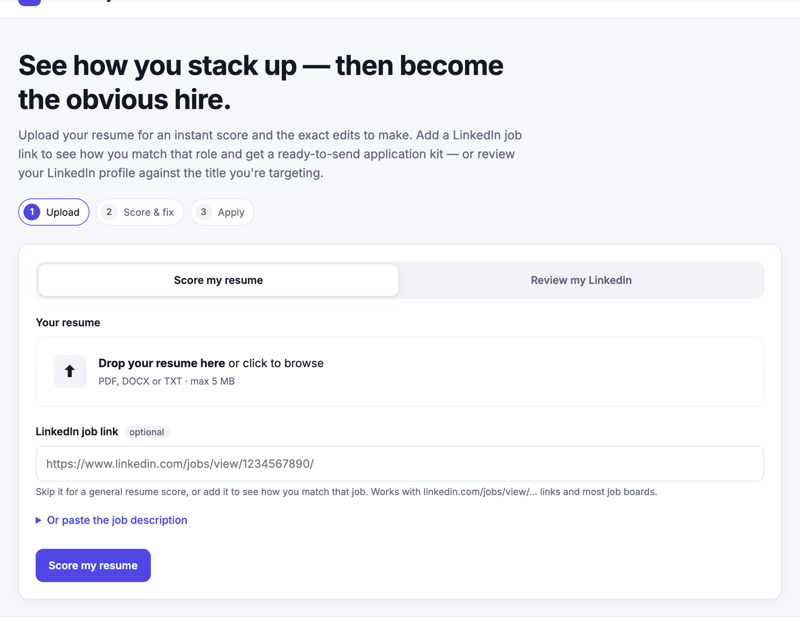
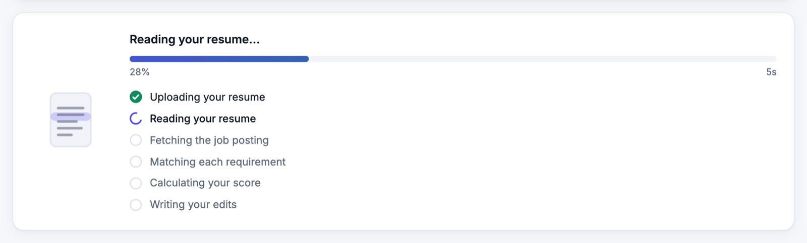
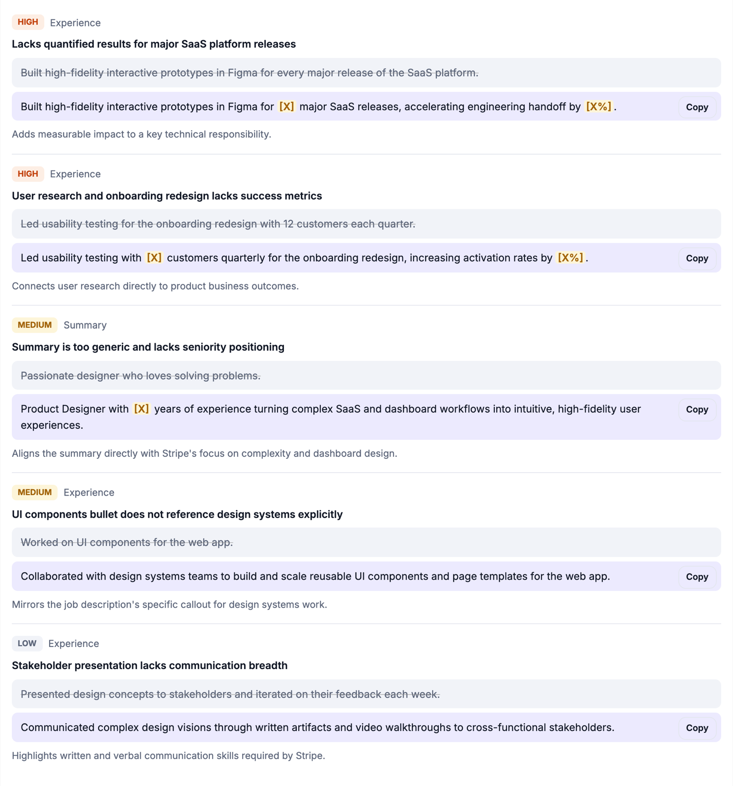

# HireReady

[](https://github.com/SalmanAhsan97/hireready/actions/workflows/tests.yml)
[](LICENSE)


[](https://web-production-7af8e.up.railway.app)



**Score your resume against a real job, see exactly which requirements you meet, and fix the gaps — with scores that don't change every time you click.**

**Live demo:** [web-production-7af8e.up.railway.app](https://web-production-7af8e.up.railway.app) (free preview, no sign-up)

HireReady reads a resume (PDF, DOCX or text), optionally pulls a LinkedIn job posting, and returns a 0–100 match score, a requirement-by-requirement check, ranked edits, an AI resume editor and a ready-to-send application kit. It can also review a LinkedIn profile against the title you're targeting.

## Screenshots

| Job match score | Requirement-by-requirement check |
|---|---|
|  |  |
| **AI resume editor** | **LinkedIn profile review** |
|  |  |

<details>
<summary>More: home, loader, ranked edits</summary>





</details>

## Why it's worth using

Job seekers usually get one of two things: a vague "78% match" that changes every time they click, or generic advice that ignores the job in front of them. HireReady is built to answer the questions that decide whether an application gets read:

- **Will I pass the screen for *this* job?** Every requirement in the posting is checked, with the line from your resume that proves it, or marked missing.
- **What exactly should I change?** Ranked, ready-to-paste edits, the keywords an ATS will search for word-for-word, and a resume editor that won't invent facts.
- **Can I trust the number?** The same resume and job always get the same score, so you can see whether an edit actually helped.
- **What do I send?** A tailored resume, cover letter and outreach messages for the role, so the candidate is positioned as a top match from the first touch.


| Flow | Input | Output |
|---|---|---|
| **Job match** | Resume + LinkedIn job link (or pasted description) | Match score, must-have / nice-to-have coverage with quoted evidence, missing keywords, ranked edits |
| **Resume score** | Resume only | General quality score for its best-fit role: keywords, impact, action verbs, structure, contact |
| **LinkedIn review** | Profile link or LinkedIn "Save to PDF" export + target title | Headline, About, keyword coverage, experience descriptions and titles, career timeline, skills, network, credibility, completeness, plus rewrites |
| **Resume chat** | Plain-language requests ("make my summary punchier") | Edited resume with live preview and .docx export |
| **Application kit** | Analysis + job | Tailored resume, cover letter, LinkedIn note, recruiter DM, hiring-manager email, interview prep |

## The interesting part: deterministic scoring

Most AI resume tools ask a model for a score, so the same resume gets a different number on every run. HireReady splits the work:

1. **The model extracts facts, once.** It lists the job's requirements (one skill per item, must-have vs nice-to-have, years, education) and quotes the resume line that supports each one. Extractions are cached by content hash, so the same inputs reuse the same facts.
2. **Code computes the score.** Python verifies every quote actually appears in the resume, matches keywords literally (with aliases and word-proximity, like an ATS), compares degree levels and years, and applies fixed weights. Same facts → same score, every time.
3. **The model explains it.** It writes rationales and suggested edits *after* the score is fixed, and is told not to re-score.

Weights follow [Jobscan's published priorities](https://www.jobscan.co/jobscan-tutorial) — hard skills first, then education, job title and other keywords — and categories the posting doesn't ask for are left out instead of awarding free points. Missing must-haves cap the score so a candidate can't look like a "top candidate" while lacking a stated requirement.

Abbreviations count for the skill ("K8s" shows Kubernetes, via a curated synonym map adapted from [ats-screener](https://github.com/sunnypatell/ats-screener), MIT), but the *ATS keyword coverage* stays word-for-word and the report tells you to add the posting's exact term, since strict ATS like Taleo search literally.

Hidden text can't buy points: white, invisible or microscopic text in a PDF is removed before scoring and the user is warned. (This trick inflated scores in [hiring-agent](https://github.com/interviewstreet/hiring-agent)'s LLM-based scorer.) White text on a dark designed panel and a scanned page's OCR layer are left alone.

Guardrails against made-up content: resume edits may only use facts from the resume or the user's own messages, and code flags any figure in an edit that appears in neither.

## Architecture

```
static/ (vanilla JS)  ──►  FastAPI  ──►  parsing.py   PDF/DOCX text (reflows wrapped bullets, recovers hyperlinks)
                                    │                Job postings: Bright Data + Apify in parallel, merged; public page fallback
                                    │                LinkedIn profiles: Apify, or the PDF export
                                    ├──►  ai.py      Claude (Anthropic SDK, structured outputs) or Gemini (JSON schema), with retries/fallback
                                    ├──►  scoring.py Deterministic scoring for job match, resume-only and LinkedIn profiles
                                    └──►  cache.py   Supabase (Postgres via PostgREST) for caches, history and rate limits; disk fallback
```

- **Backend:** Python 3.12, FastAPI, Pydantic, httpx, pypdf, python-docx
- **AI:** Anthropic Claude (default when a key is set) or Google Gemini
- **Data:** Bright Data and Apify scrapers for LinkedIn jobs and profiles
- **Storage:** Supabase Postgres, row-level security on, server-only access
- **Frontend:** vanilla HTML/CSS/JS — animated splash, staged loader with real upload progress, light/dark themes
- **Deploy:** Docker on Railway, auto-deploy from `main`

## Plans and how they're funded

**The scoring is the same on every plan.** Free and paid run the same extraction model, the same scoring engine and the same checks, so nobody pays for a better number. The one input difference: a free job *link* is read from LinkedIn's public page instead of the paid scrapers, so it can carry less of the posting. Pasting the full description gives a free user exactly the Pro input. What a subscription buys is depth, and the cost of producing it.

| | Free preview | Pro (subscription) |
|---|---|---|
| Match / resume / LinkedIn score and category bars | ✓ | ✓ |
| File warnings (e.g. hidden text) | ✓ | ✓ |
| Requirement-by-requirement check with quoted evidence | — | ✓ |
| Missing keywords, all ranked edits, strengths, gaps, red flags | first of each | ✓ |
| Explanations and rewrites written by the premium model | — | ✓ |
| Resume chat, application kit, .docx and PDF export | — | ✓ |
| Job links read with Bright Data + Apify (fuller postings) | public page | ✓ |

**Where the subscription goes.** Most of each subscription pays for what makes the paid output better: the premium model for writing (`HIREREADY_PREMIUM_MODEL`), Bright Data and Apify credits for complete job postings and profiles, and hosting and storage. The rest of it funds refining the scoring engine, such as a labelled set of resume/job pairs to calibrate weights against real screening outcomes. A small share keeps the project maintained.

**How the premium model is used.** Paid requests send the *writing* (rationales, rewrites, resume chat, application kit) to a stronger model, e.g. `claude-opus-5-5` or `gemini-pro-latest`. Fact extraction, which feeds the score, always uses the standard model, so scores are comparable across plans. If the premium model is busy, the request falls back to the standard model instead of failing.

**Today:** Pro is unlocked with an access code issued on request (`HIREREADY_ACCESS_CODE`). The owner signs in from the header (`HIREREADY_ADMIN_USER` / `HIREREADY_ADMIN_PASSWORD`) for the full version without daily limits; the session is an HttpOnly cookie and sign-in locks after repeated failures. Runs made while signed in as admin are saved to Supabase (with the resume text) and listed under **Saved resumes & jobs** with their last-used date and a Preview button that reopens the full report without re-running it. Visitors' resume text is never stored, only a fingerprint. Locked sections are removed server-side, not just hidden in the browser. Free job-link previews never spend paid scraper credit, and every visitor has daily limits. Self-serve billing is the next step.

## Quality commitments for every user

The free tier gets the best scoring the current stack can do. No accuracy is held back for upselling:

- **Deterministic:** the model extracts facts once (cached by content hash), and Python scores them with fixed weights.
- **Evidence-checked:** quotes the model cites must actually appear in the resume, and claims without support are downgraded.
- **ATS-realistic keywords:** literal matching with plurals, word proximity and a curated synonym map, while flagging terms that strict ATS would miss.
- **Fair gaps:** categories the posting doesn't ask for, and profile fields a source can't see, are left out rather than scored as zero.
- **Honest caps:** missing must-haves cap the score.
- **Tamper-resistant:** hidden PDF text is removed before scoring.
- **Best data available:** job postings are merged from Bright Data and Apify, with LinkedIn's public page as a fallback, and profiles come from Apify or the LinkedIn PDF export.
- **Resilient:** model calls retry with backoff and fall back to a lighter model with its own quota.

## Run it locally

```bash
git clone https://github.com/SalmanAhsan97/hireready.git
cd hireready
python3 -m venv .venv && .venv/bin/pip install -r requirements.txt
cp .env.example .env   # add an AI key; everything else is optional
.venv/bin/uvicorn app.main:app --port 8765 --reload
```

Open http://localhost:8765. With no AI key set, the app runs in demo mode with sample results so the whole flow can be clicked through.

Database tables are in [`supabase/migrations/`](supabase/migrations).

## Tests

```bash
.venv/bin/pip install -r requirements-dev.txt
.venv/bin/python -m pytest -q
```

The suite runs offline — no API keys, no database — and covers what the product promises: identical scores for identical inputs, quotes checked against the resume, degree comparison, ATS-style keyword matching, PDF line reflow, server-side redaction of the free preview, and access control. It runs on every push via GitHub Actions.

## License

[MIT](LICENSE)

## Author

Built by **Salman Ahsan** — marketing and growth professional with an MS in Business Analytics.
[LinkedIn](https://www.linkedin.com/in/salmanahsan9/) · [Portfolio](https://salmansworkportfolio.my.canva.site/salman-ahsan/)
